# Asignación #2 — AAA, RADIUS, Active Directory y NPS

> **Video de demostración:** [🎥 Ver video](https://youtu.be/1wH4d278C8E)

**Asignatura:** Seguridad de Redes  
**Estudiante:** Luis Ariel Alevante Agramonte  
**Matrícula:** 2025-2174  

---

## 1. Objetivo

Implementar una infraestructura en GNS3 para centralizar la **autenticación, autorización y accounting (AAA)** de un router y un switch Cisco mediante **RADIUS**, utilizando un servidor Windows Server con **Active Directory Domain Services (AD DS)** y **Network Policy Server (NPS)**.

La práctica demuestra que:

- `R1` y `SW-2174` utilizan el servidor NPS como servidor RADIUS.
- El servidor Windows administra usuarios y grupos desde Active Directory.
- Se aplican distintos niveles de privilegio mediante **Cisco AV-Pair**.
- Los accesos por consola y puerto auxiliar utilizan autenticación y autorización AAA/RADIUS.
- Las líneas VTY permiten acceso por **SSH** mediante un usuario local de respaldo.
- Los eventos de login exitoso y fallido quedan habilitados para logging.
- Se utiliza accounting de sesiones EXEC hacia RADIUS.
- Los usuarios de prueba reciben distintos niveles de privilegio según su grupo/política.

---

## 2. Topología

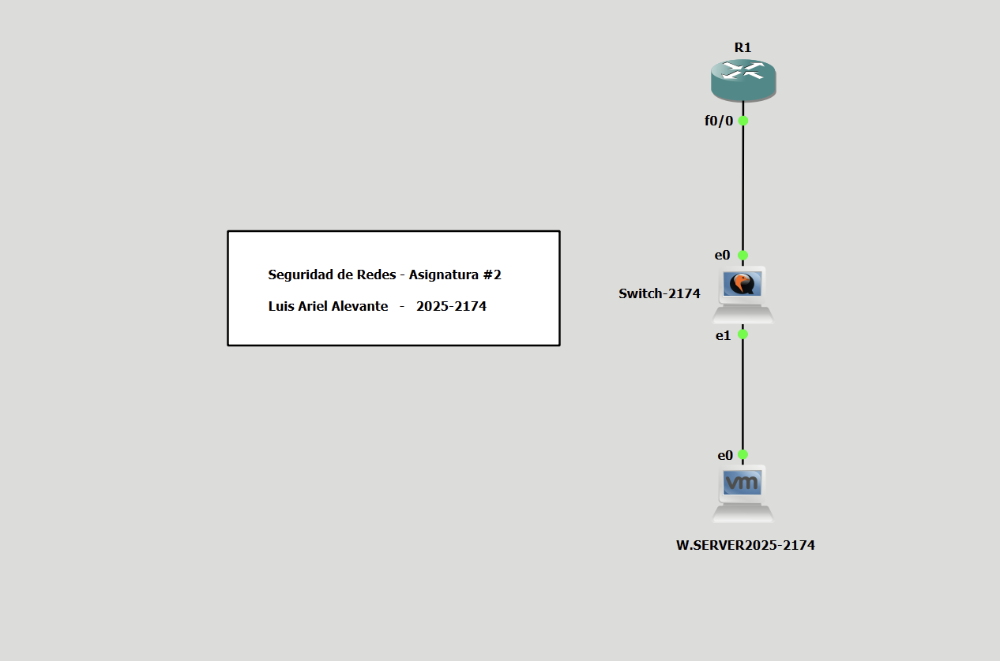

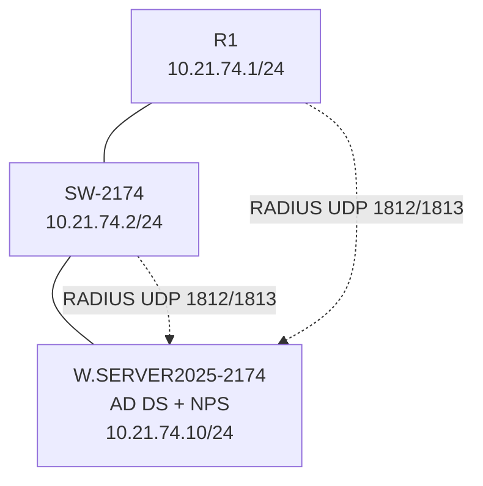

---

## 3. Plan de direccionamiento

| Equipo | Interfaz / función | Dirección |
|---|---|---|
| `R1` | `FastEthernet0/0` | `10.21.74.1/24` |
| `SW-2174` | `Vlan1` | `10.21.74.2/24` |
| `W.SERVER2025-2174` | Servidor AD DS / NPS | `10.21.74.10/24` |
| `SW-2174` | Default Gateway | `10.21.74.1` |

---

## 4. Componentes del entorno

- **GNS3**
- **GNS3 VM sobre VMware**
- **1 × Router Cisco IOSv / R1**
- **1 × Switch Cisco IOSvL2 / SW-2174**
- **1 × Windows Server**
  - Active Directory Domain Services
  - Network Policy Server
- **RADIUS**
  - UDP/1812 — Authentication
  - UDP/1813 — Accounting
- **SSH v2**
- **AAA — Authentication, Authorization and Accounting**

---

## 5. Configuración implementada

### 5.1 Active Directory

Se creó la estructura de usuarios y grupos utilizada para asignar los diferentes niveles de acceso.

Grupos configurados:

- `NIVEL-0`
- `NIVEL-5`
- `NIVEL-10`

Usuarios de prueba:

- `USER0`
- `USER5`
- `USER10`

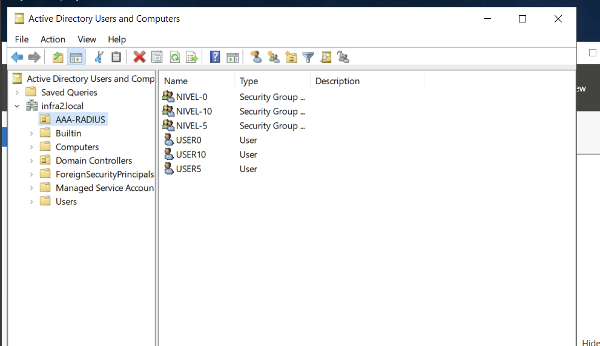

---

### 5.2 Network Policy Server

En NPS se configuraron políticas independientes para controlar los niveles de privilegio.

Políticas utilizadas:

- `NIVEL-0-RADIUS`
- `NIVEL-5-RADIUS`
- `NIVEL-10-RADIUS`

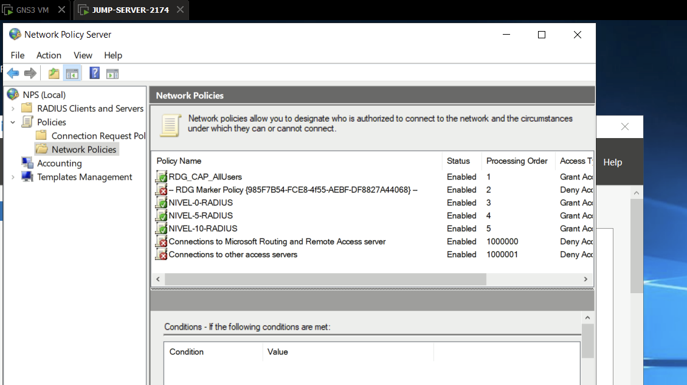

---

### 5.3 Clientes RADIUS

El router y el switch fueron registrados como clientes RADIUS en NPS.

| Friendly Name | Dirección IP |
|---|---|
| `R1-2174` | `10.21.74.1` |
| `SW-2174` | `10.21.74.2` |

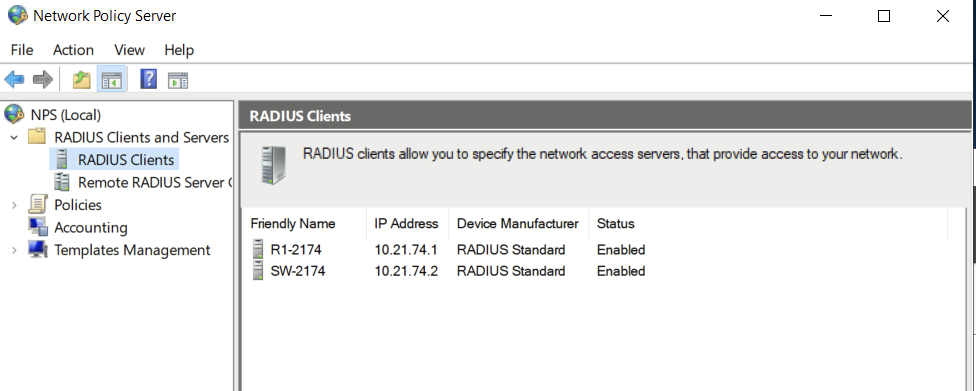

---

### 5.4 Asignación de privilegios mediante Cisco AV-Pair

NPS entrega el nivel de privilegio al dispositivo Cisco utilizando atributos Vendor Specific.

#### Nivel bajo

Durante la implementación se utilizó un nivel efectivo **2** para el usuario restringido.

```text
Cisco-AV-Pair
shell:priv-lvl=2
```

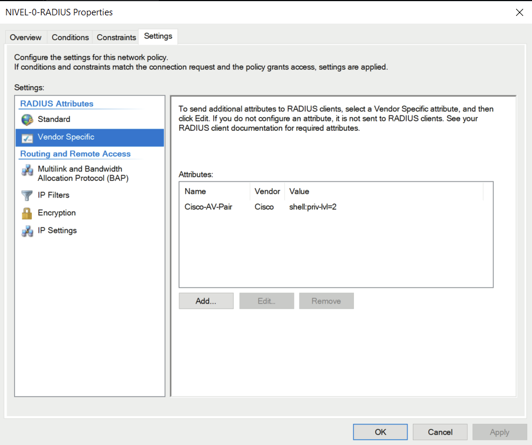

#### Nivel 5

```text
Cisco-AV-Pair
shell:priv-lvl=5
```

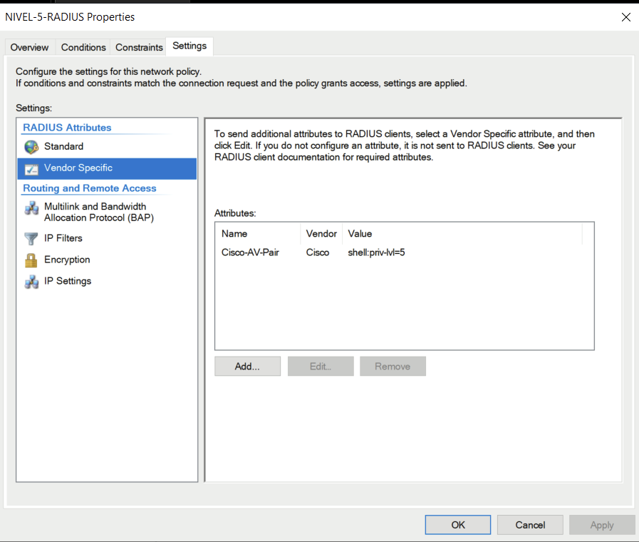

#### Nivel 10

```text
Cisco-AV-Pair
shell:priv-lvl=10
```

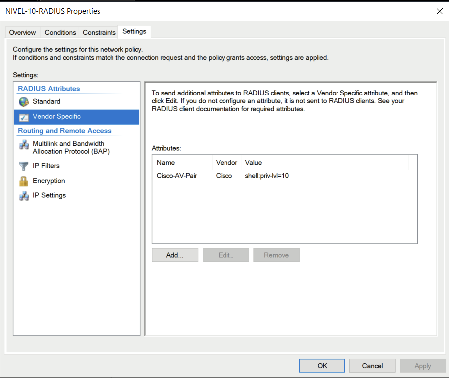

---

### 5.5 AAA en R1

`R1` utiliza AAA para autenticación, autorización y accounting.

Configuración principal:

```text
aaa new-model
aaa authentication login AAA-RADIUS group radius
aaa authentication login SSH-LOCAL local
aaa authorization console
aaa authorization exec AAA-RADIUS group radius if-authenticated
aaa accounting exec AAA-RADIUS start-stop group radius
```

El servidor RADIUS utilizado es:

```text
10.21.74.10
Authentication: UDP/1812
Accounting: UDP/1813
```

Las líneas `console` y `aux` utilizan `AAA-RADIUS`.

Las líneas VTY utilizan autenticación local y aceptan únicamente SSH.

---

### 5.6 AAA en SW-2174

El switch utiliza un grupo de servidores RADIUS denominado `RADIUS-GRP`.

Configuración principal:

```text
aaa new-model
aaa group server radius RADIUS-GRP
 server name NPS-RADIUS

aaa authentication login AAA-RADIUS group RADIUS-GRP
aaa authentication login SSH-LOCAL local
aaa authorization console
aaa authorization exec AAA-RADIUS group RADIUS-GRP
aaa accounting exec AAA-RADIUS start-stop group RADIUS-GRP
```

La interfaz de origen de RADIUS es:

```text
ip radius source-interface Vlan1
```

El servidor configurado es:

```text
radius server NPS-RADIUS
 address ipv4 10.21.74.10 auth-port 1812 acct-port 1813
```

---

### 5.7 Logging

En ambos dispositivos se habilitaron registros de login exitoso y fallido.

```text
login on-failure log
login on-success log
logging buffered 32768 informational
```

Esto permite mantener evidencia local de intentos de acceso.

---

## 6. Validación

### 6.1 Usuario nivel 5

El usuario `USER5` fue autenticado mediante RADIUS.

```text
show privilege
```

Resultado:

```text
Current privilege level is 5
```

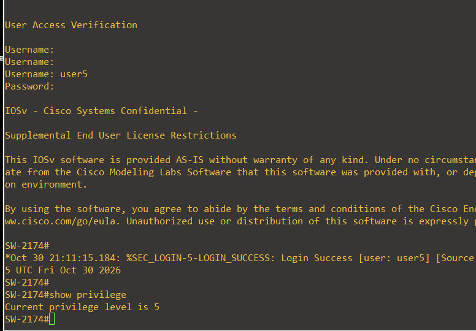

---

### 6.2 Usuario de nivel bajo

El usuario `USER0` fue autenticado correctamente y recibió un nivel restringido.

```text
show privilege
```

Resultado:

```text
Current privilege level is 2
```

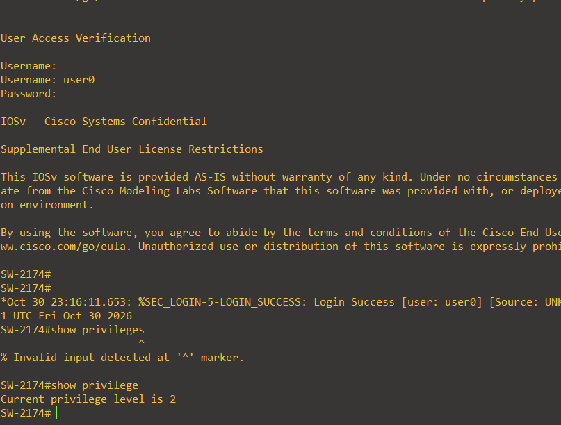

> El nivel efectivo utilizado en esta implementación fue `2`, aunque el grupo/política corresponde al nivel bajo solicitado por la práctica.

---

### 6.3 Usuario nivel 10

El usuario `USER10` fue autenticado mediante RADIUS en `R1`.

```text
show privilege
```

Resultado:

```text
Current privilege level is 10
```

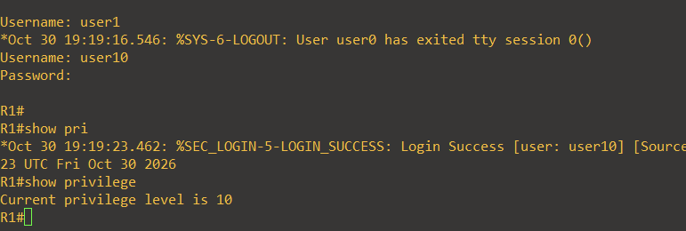

---

### 6.4 SSH hacia R1

Se validó el servicio SSH del router mediante el usuario local de respaldo.

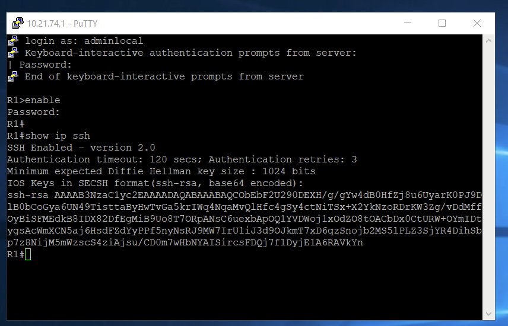

La configuración final utiliza:

```text
line vty 0 4
 login authentication SSH-LOCAL
 transport input ssh
```

---

### 6.5 SSH hacia SW-2174

Se validó el servicio SSH del switch mediante el usuario local de respaldo.

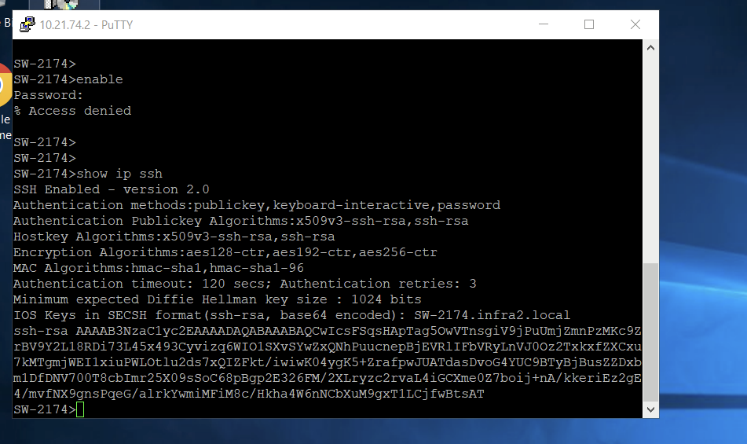

También se verificó:

```text
show ip ssh
```

confirmando SSH versión 2.

---

## 7. Evidencias principales

| Evidencia | Descripción |
|---|---|
| [`01-topologia-final.png`](evidencias/01-topologia-final.png) | Topología final de la asignación |
| [`02-active-directory-usuarios-grupos.png`](evidencias/02-active-directory-usuarios-grupos.png) | Usuarios y grupos de Active Directory |
| [`03-nps-network-policies.png`](evidencias/03-nps-network-policies.png) | Políticas configuradas en NPS |
| [`04-nps-radius-clients.png`](evidencias/04-nps-radius-clients.png) | R1 y SW registrados como clientes RADIUS |
| [`05-nivel-bajo-avpair-priv2.png`](evidencias/05-nivel-bajo-avpair-priv2.png) | Cisco AV-Pair del usuario restringido |
| [`06-nivel5-avpair.png`](evidencias/06-nivel5-avpair.png) | Cisco AV-Pair de nivel 5 |
| [`07-nivel10-avpair.png`](evidencias/07-nivel10-avpair.png) | Cisco AV-Pair de nivel 10 |
| [`08-user5-privilege5.png`](evidencias/08-user5-privilege5.png) | Validación de privilege 5 |
| [`09-user0-privilege2.png`](evidencias/09-user0-privilege2.png) | Validación del usuario restringido |
| [`10-user10-privilege10.png`](evidencias/10-user10-privilege10.png) | Validación de privilege 10 |
| [`11-r1-ssh-local.png`](evidencias/11-r1-ssh-local.png) | Servicio SSH en R1 |
| [`12-sw-ssh-local.png`](evidencias/12-sw-ssh-local.png) | Servicio SSH en SW-2174 |

---

## 8. Running-configs

Las configuraciones finales están disponibles en [`running-configs/`](running-configs/):

- `R1-running-config.txt`
- `SW-2174-running-config.txt`

> **Seguridad:** las contraseñas, secretos y claves RADIUS aparecen redactados en los archivos publicados. La configuración funcional de AAA, RADIUS, logging, interfaces y SSH se conserva.

---

## 9. Scripts y comandos de validación

La carpeta [`scripts/`](scripts/) contiene los comandos utilizados para verificar el laboratorio:

- `comandos-validacion.txt`

Entre ellos:

```text
show running-config
show privilege
show ip ssh
show logging
show aaa servers
ping 10.21.74.10
```

---

## 10. Resultado

La infraestructura cumple el objetivo principal de centralizar la autenticación y autorización administrativa mediante **Active Directory + NPS + RADIUS**.

Las pruebas realizadas demuestran que:

- R1 y SW-2174 están registrados como clientes RADIUS.
- NPS dispone de políticas separadas para los distintos niveles.
- Los niveles se entregan mediante Cisco AV-Pair.
- `USER0` opera con privilegios restringidos.
- `USER5` recibe privilegio 5.
- `USER10` recibe privilegio 10.
- Consola y AUX utilizan AAA/RADIUS.
- SSH está habilitado en ambos dispositivos.
- Existe un usuario local de respaldo.
- El accounting EXEC está habilitado.
- Los eventos de login exitoso y fallido son registrados.

---

## Estructura del repositorio

```text
SR-ASIGNACION-2-AAA-RADIUS-NPS/
├── README.md
├── docs/
│   └── validacion.md
├── evidencias/
│   ├── 01-topologia-final.png
│   ├── 02-active-directory-usuarios-grupos.png
│   ├── 03-nps-network-policies.png
│   ├── 04-nps-radius-clients.png
│   ├── 05-nivel-bajo-avpair-priv2.png
│   ├── 06-nivel5-avpair.png
│   ├── 07-nivel10-avpair.png
│   ├── 08-user5-privilege5.png
│   ├── 09-user0-privilege2.png
│   ├── 10-user10-privilege10.png
│   ├── 11-r1-ssh-local.png
│   └── 12-sw-ssh-local.png
├── running-configs/
│   ├── R1-running-config.txt
│   └── SW-2174-running-config.txt
└── scripts/
    └── comandos-validacion.txt
```
